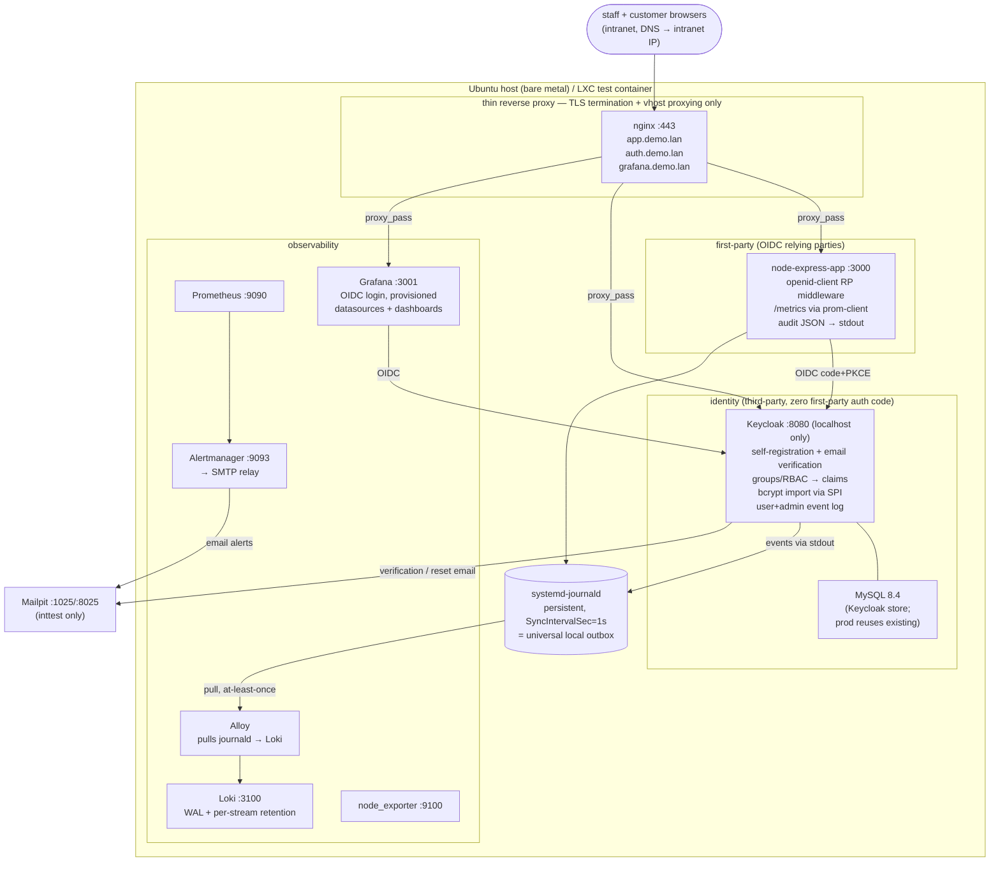
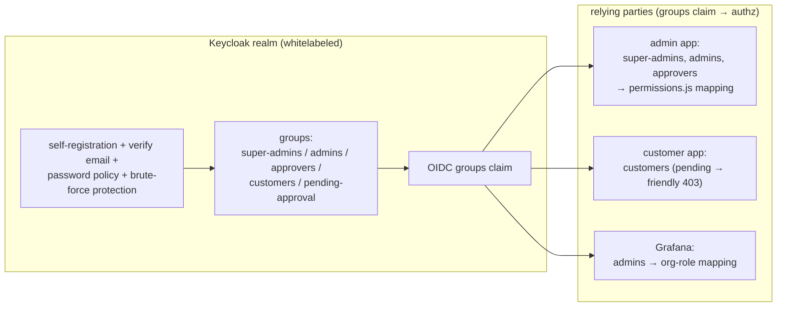
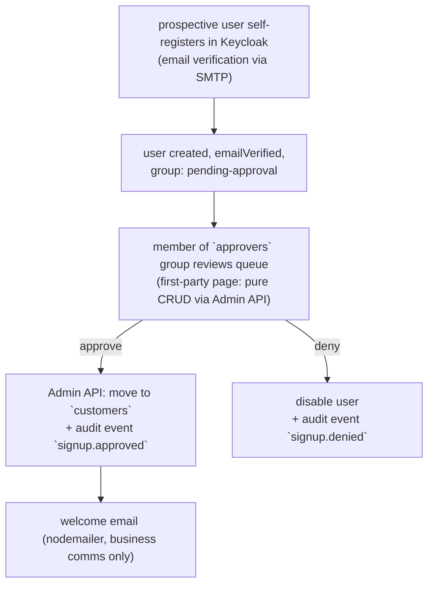
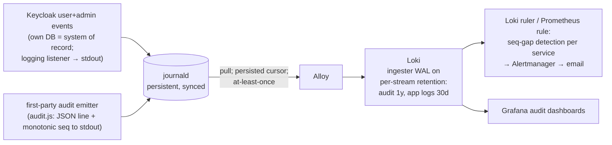

# Plan: Scope Reduction via Reputable OSS (Bare-Metal, Ansible-Managed)

Status: proposal, rev 4 — IdP-first milestone pulled ahead; Keycloak datastore
swapped to MySQL (production reuses the existing shared instance); bcrypt import
format verified against the SPI source. Rev 3 selected Keycloak; rev 2 was the
IdP rescope. Audit-durability claims validated per component. Revised after
reviewing the authorized DB dump (`~/backups/mysql-all-20261027-121001.sql.gz`)
and the Admin auth/audit code. Versions and distribution channels verified
against official sources on 2026-11-09/10 (links inline).

## 1. Goals and constraints

Replace bespoke security-critical functionality with reputable open-source
implementations, deployed **bare metal** (no Docker — tech-lead directive), while
keeping:

- All provisioning in Ansible, all orchestration/tests in TypeScript run by Node
  (repo invariants in `AGENTS.md`).
- The LXC container as **test-target simulator only** (`scripts/lxd.ts` + inttest);
  roles must never know containers exist.
- The `app_backend` conditional and `backend_container.yml` seam so containerization
  (Podman/LXC) can be introduced later without redesign.
- Systemd services configured via `EnvironmentFile`, per the existing
  `node-express.service.j2` pattern.
- **First-party code minimized** (rotating student-team maintainers): anything that
  is not business-differentiating moves to reputable OSS — auth is the top
  candidate for deletion.

Software being added:

| Concern            | Replaces (in ~/Documents/Code/Admin)                        | Chosen OSS            |
|--------------------|-------------------------------------------------------------|-----------------------|
| Auth / SSO / MFA / **signup** | bespoke sessions, login history, known devices, passkeys, email verification, and any first-party signup form | **Keycloak 26.8.x** — whitelabeled IdP for customers **and** staff, with self-registration, email verification, brute-force protection, RBAC (see §5 for why Keycloak over Authelia/ZITADEL/Authentik) |
| Keycloak datastore | — | **MySQL 8.4** (Ubuntu pkg, inttests only; production reuses the existing shared MySQL) — Keycloak 26.8 supports MySQL 8.0/8.4 LTS with a bundled driver; H2 is not production-supported and Postgres would add a second database to prod infra |
| OIDC login in first-party apps | ad-hoc session/token code | **`openid-client`** (certified Node RP library, IdP-agnostic) |
| Reverse proxy      | — (new, thin: TLS termination + vhost proxying only, **no auth logic**) | **nginx** (Ubuntu pkg) |
| RBAC               | `permissions.js`, `AdminRoles` table, string roles `SuperAdmin`/`Admin` | Keycloak **groups** → OIDC `groups` claim → first-party group→permission mapping |
| Signup approval    | `approval_requests` + `/approval/:id/approve|deny` | **pending-group gate** (zero auth code) + one first-party CRUD call to Keycloak's supported Admin API (§6) |
| Metrics            | `monitoringMetrics.js`, hand-rolled health endpoints | **Prometheus 3.x + node_exporter + prom-client** in the app |
| Logs + audit trail | `adminActivityLogs.js` (DB), `loginHistoryService.js` (DB), console.log | **Loki 3.7.x**, shipped by **Grafana Alloy** from journald; durable audit pipeline (§7) |
| Dashboards         | none                                                        | **Grafana OSS 13.x** (provisioned as code, OIDC login) |
| Email (verification / reset / notifications) | `emailAlerts.js`, `emailService.js`, `approvalEmailService.js` | **Keycloak SMTP** (verification/reset) + `nodemailer` first-party (approval notices), same relay |

## 2. Verified facts (do not re-derive from memory)

| Package        | Version (2026-11) | Official bare-metal channel                                             |
|----------------|-------------------|--------------------------------------------------------------------------|
| Keycloak       | 26.8.x (26.8.2)   | Official ZIP/TAR.GZ from keycloak.org / GitHub releases (sha1 checksums). **"Bare Metal / Virtual Machines" is an explicitly supported configuration.** Quarkus-based; needs Java 21 (`openjdk-21-jre` Ubuntu pkg) + MySQL 8.0/8.4 (`KC_DB=mysql`, driver bundled). **Measured boot times (2026-11-10, LXC inttest + docker repro): fresh-schema cold boot ~220–250s — per-DDL Liquibase overhead dominates, not fsync (test knobs `innodb_flush_log_at_trx_commit=2` + `sync_binlog=0` help marginally); warm restart ~10s, which is the only number that matters for auth availability.** The server binds ports immediately and 503s while bootstrapping; poll `/health/ready` on the management port :9000 — not the aggregate `/health`, which a single-node jdbc-ping setup reports `DOWN` via a spurious cluster-health check. https://www.keycloak.org/downloads , https://www.keycloak.org/server/supported-configurations |
| MySQL          | 8.4 LTS (Ubuntu pkg; Ubuntu 26.04 ships 8.4.x) | Keycloak's supported datastore for this deployment. In-process alternatives are H2 (dev-only, not prod-supported) — MySQL is already part of prod infra. inttest-only `mysql` role provisions a throwaway instance. **Gotcha (verified 2026-11-10): `community.mysql` hardcodes `CREATE USER … IDENTIFIED WITH mysql_native_password` for MySQL ≥ 8, but 8.4 ships that plugin disabled by default — the role re-enables it in its config drop-in (`mysql_native_password=ON`, startup-only option; gone entirely in MySQL 9.x).** |
| nginx          | Ubuntu pkg        | Thin proxy only: TLS termination + vhost proxying. No auth modules used. |
| Prometheus     | 3.16.0            | Upstream tarball + `.sha256` from GitHub releases (Ubuntu `prometheus` pkg is 2.x — too old). https://prometheus.io/download/ |
| Alertmanager   | 0.35.0            | Upstream tarball + `.sha256`.                                            |
| node_exporter  | 1.12.1            | Upstream tarball + `.sha256`.                                            |
| Grafana OSS    | 13.3.x            | Official APT repo `https://apt.grafana.com stable main`; deb ships `grafana-server.service` using `EnvironmentFile=/etc/default/grafana-server`. Generic OIDC support for IdP login. |
| Loki           | 3.7.9             | Upstream binary + systemd unit we write. Single-binary mode, TSDB schema v13, filesystem storage. |
| Grafana Alloy  | 1.21.x            | Same `apt.grafana.com` repo, package `alloy`. **Promtail is deprecated/EOL.** `loki.source.journal` needs `alloy` in `adm,systemd-journal` groups. |
| Mailpit        | 1.33.1            | Single static Go binary. SMTP catch-all (tcp/1025) + REST API (`/api/v1/messages`) for assertions. **Test-only.** |
| keycloak-bcrypt SPI | 1.7.0        | `github.com/leroyguillaume/keycloak-bcrypt` — widely deployed community plugin that adds a bcrypt `PasswordHashProvider`, enabling Admin-API user creation with the modern credential format `credentials: [{type: 'password', secretData: '{"value":"<$2b$…>","salt":""}', credentialData: '{"algorithm":"bcrypt","hashIterations":10}'}]` (verified against the SPI source: the provider stores the full hash as the secret with an empty salt; `hashedSaltedValue` is deprecated). Pin + checksum the jar via Ansible. The SPI's verifier accepts all `$2` variants (verified empirically 2026-11-10: `$2a$`, `$2b$`, `$2y$` all log in unmodified — no hash-prefix normalization needed). Keycloak's default hashing algorithm stays **Argon2** — imported credentials are transparently rehashed to Argon2 on first login. |
| prom-client / openid-client / bcryptjs / mysql2 / nodemailer | current | npm. |

Key integration facts verified:

- **Keycloak self-registration is a mature, configurable flow**: realm setting
  "User registration", plus per-realm flows for email verification, terms &
  conditions, password policies, required actions, reCAPTCHA/bot detection.
  This is exactly the code we refuse to let students write.
- **Keycloak does NOT have built-in admin-approval on registration**
  (open feature request keycloak#49679). The standard patterns: (a) registrants
  land in a `pending-approval` group and apps gate on claims — zero auth code;
  (b) community SPI extensions (e.g. phasetwo admin-approval). We choose (a) (§6).
- **Keycloak bcrypt import requires the third-party SPI plugin** above (no native
  bcrypt). Fallbacks if the plugin is rejected: LDAP federation with
  `{CRYPT}$2b$…` (libxcrypt on Ubuntu supports bcrypt), or forced password reset.
  The Admin dump confirms all live hashes are `$2b$` (§3), so the plugin path is
  a straight import.
- **Keycloak audit events are first-class**: user events + admin events,
  persisted to the DB (queryable, retention-configurable in-realm) *and* the
  built-in logging event listener writes `type=LOGIN, …` structured lines to the
  `org.keycloak.events` log category → stdout → journald under systemd.
  Registration, login failures, admin mutations all emit events.
- **Keycloak realm configuration is code**: realm JSON via `--import-realm`
  (start-time idempotent import of missing objects) or the Admin REST API; a
  maintained Ansible collection exists (`middleware_automation.keycloak` — verify
  current maintenance at implementation).
- **ZITADEL v4.20 (runner-up)**: documented Linux **binary** install (Go, needs
  PostgreSQL), native documented **bcrypt bulk import**
  (`hashedPassword: {value: "$2b$…", algorithm: "bcrypt"}` via `POST /admin/v1/import`),
  Terraform provider, OpenID-certified OP, event-sourced audit trail. Rejected
  only on ecosystem/community depth vs Keycloak (§5).
- **Grafana listens on tcp/3000 by default** — conflicts with the app →
  `GF_SERVER_HTTP_PORT=3001`.
- **Loki 3.x** single binary: TSDB schema v13, filesystem storage; **ingester WAL
  exists and is configurable** (`ingester.wal.enabled`, checkpoint, flush-on-
  shutdown) — must be enabled for crash-durable ingestion; **per-stream retention
  is supported** (`limits_config.retention_stream` selectors with priority/period,
  enforced by the compactor with `retention_enabled: true`) — audit streams get
  longer retention than app logs. Default retention is "forever" unless enabled.

## 3. What the authorized DB dump actually contains

Findings that shape the import and RBAC design (from
`~/backups/mysql-all-20261027-121001.sql.gz`; databases `dc` (live), `dc_staging`,
`GroupM_Test`, `digiclips`, `digiclips_chat`, `new_dc`):

- **Three credential formats coexist** in the `dc` schema:
  1. `Admins` (current admin table): **29 accounts, all `$2b$10$` bcrypt**, role by
     numeric id → `AdminRoles` (e.g. `2='Super Administrator'` with permission
     `all`, `4='Customer Support'`, `22='Student Administrator'`, `23='IT
     Manager'` — comma-separated permission lists).
  2. `admins` (legacy): 2 accounts with bcrypt, the rest a **64-byte hex digest +
     separate 8-byte salt** — a pre-bcrypt format the current code never verifies
     (it calls `bcrypt.compare` against a hex string; always fails). Dead
     credentials → import as **disabled, forced password reset**.
  3. `users` (customers, "General Public"): mixed — 39 current accounts with
     `$2b$10$` bcrypt, rest same legacy hex+salt format (same treatment).
  → **All live credentials are `$2b$` bcrypt** (npm `bcrypt`/`bcryptjs`,
  interoperable). Import path confirmed: verbatim hash copy through the bcrypt
  SPI (or native import, had we picked ZITADEL).
- **Roles**: `SuperAdmin` (sysadm) and `Admin` (siteadm) string roles on the
  legacy table; numeric role ids + granular permission lists on `Admins`/
  `AdminRoles`. Both map into IdP groups (§6).
- **Signup approval exists**: `approval_requests` (`pending` → approve/deny),
  driven by `POST /approval/request` (shared-secret caller) and audited admin
  actions `/approval/:id/approve|deny` (`approvalRoutes.js`).
- **Audit surface today** (must be preserved/superseded — §7):
  - `admin_activity_logs`: actor email/name, method, path, status, target
    type/label, description, timestamp, request_body_snippet
    (`adminActivityRegistry.js` catalogues ~30 audited mutations: user
    verification/deletion, admin CRUD, role CRUD + permission changes, role-error
    mappings, TV config CRUD, email config change, guest search resets, demo
    request status, customer add, subscriber options/alerts, link-monitor CRUD,
    auto-delete config/runs, layout/UI customization, signup approvals).
  - `admin_login_history`: email, ip, user agent, login method, device info.
  - `admin_known_devices`, `admin_passkeys`, `email_logs`, `password_reset_tokens`.

## 4. Target architecture (single host, all native systemd services)

Exposure model: services are **intranet-only**; the intended production pattern is
public DNS records (e.g. `app.example.com`) pointing at intranet IPs, with nothing
routed from the internet. No VPN architecture is designed here; the demo keeps
nginx as the single TLS entry point, identical however the intranet is reached.
Keycloak is whitelabeled (realm display name, theme, logo) and is the IdP for
both customers and staff.

## 5. IdP selection — research, criteria, conclusion

### Candidates assessed (2026-11)

| IdP | Official bare-metal dist | Self-service signup | Approval on signup | bcrypt import | Audit events | Notes |
|---|---|---|---|---|---|---|
| **Keycloak 26.8** (Apache-2.0, CNCF) | ✅ ZIP/TAR.GZ; "Bare Metal" is a documented supported configuration | ✅ mature flow (email verify, terms, password policy, required actions, bot detection) | ❌ open request keycloak#49679 → use pending-group gate (zero auth code) or community SPI | ⚠️ via maintained community SPI (`leroyguillaume/keycloak-bcrypt`); fallback LDAP `{CRYPT}` or forced reset | ✅ user + admin events: DB-persisted **and** structured log lines → journald | biggest docs/community; Ansible collection + `--import-realm`; JVM footprint (~0.5–1 GB) |
| **ZITADEL v4.20** (Apache-2.0) | ✅ documented Linux binary + systemd; needs PostgreSQL | ✅ register form + email OTP | ❌ (same gap → same gate pattern) | ✅ **native documented bulk import** (`algorithm: "bcrypt"`) | ✅✅ event-sourced audit trail in PG | great IaC (Terraform), OpenID-certified OP, small footprint; smaller community |
| Authelia 4.39 | ✅ official APT/deb | ❌ **no registration at all** (roadmap: ideation phase) | ❌ | ✅ file backend | ⚠️ stdout security log | was rev-2 pick; disqualified by the signup requirement |
| Authentik | ❌ OCI container only (Docker/Podman) | ✅ | ✅ (flows) | ✅ | ✅ | disqualified on distribution channel |
| Casdoor | ⚠️ binaries on releases, no documented install path | ✅ | ❌ | ✅ native (bcrypt is its default) | ⚠️ basic | smaller project, weaker certification/governance |
| Ory (Kratos etc.) | ✅ Go binaries | ✅ API-only | ❌ | ✅ | ⚠️ | headless → registration UI becomes first-party code (defeats the purpose) |
| FusionAuth | ✅ deb/rpm | ✅ | ❌ | ✅ | ✅ | **not open source** (free but proprietary) |
| Janssen/Gluu | ✅ debs | ✅ | ⚠️ | ⚠️ | ✅ | very heavy (Java) for a student-run team |

### Criteria (weighted for this team)

1. **No first-party auth code** — signup, verification, reset, session, MFA must
   all be IdP features (hard requirement per the intern-turnover argument).
2. **Official non-container distribution** (hard requirement: no Docker).
3. **`$2b$` bcrypt import without plaintext** (hard requirement; 72-byte
   truncation parity is inherent to bcrypt).
4. **RBAC via groups/roles in OIDC claims** + outbound SMTP + whitelabeling.
5. **Audit events** emitted for auth actions, exportable to the central pipeline.
6. **Operations survivability under rotating student maintainers** — docs depth,
   community size, searchability of answers, IaC story.
7. Footprint and runtime dependencies (MySQL 8.4 acceptable — already part of
   prod infra; JVM acceptable).

### Conclusion

**Keycloak 26.8.x.** It is the only candidate that simultaneously (a) documents
bare metal as a supported deployment, (b) ships the hardened self-service
registration/verification/reset flows we must not write ourselves, (c) is
OpenID-certified with the deepest community for interns, and (d) emits
DB-persisted *and* journald-exportable audit events. Its one real gap — bcrypt
import — is closed by a single, widely-deployed community SPI jar vendored and
pinned by Ansible, with two documented fallbacks.

**ZITADEL** is the runner-up and the designated **swap**: if the bcrypt SPI is
unacceptable or the JVM footprint hurts, ZITADEL's native bcrypt import and
smaller footprint make migration cheap — the app-side `openid-client` RP and
nginx layers are IdP-agnostic, so swapping IdPs touches only the `keycloak` role
and realm file, not first-party code. This is deliberate insurance.

## 6. Auth design (OIDC-first, no proxy auth, no bespoke signup)

**The reverse proxy does no authentication.** nginx terminates TLS and proxies
vhosts; every access-control decision lives in Keycloak (as the IdP) or in the
first-party app (as the relying party, enforcing authz from verified `groups`
claims).

- **RBAC mapping** (dump §3 → IdP): `SuperAdmin` → `super-admins`; `Admin` →
  `admins`; approved customers → `customers`; registrants awaiting approval →
  `pending-approval`; anyone allowed to approve signups → `approvers`
  (requirement (c): only `super-admins`/`admins` members hold `approvers`).
  First-party `rbac.js` maps `groups` claims onto the existing granular
  `permissions.js` list, so `AdminRoles`-style permission sets (e.g. `IT
  Manager`) remain expressible as group compositions.
- **Signup + approval workflow** — registration is Keycloak's flow; approval is a
  group promotion using the supported Admin API:

  The first-party surface here is one queue page and two REST calls to a
  documented Admin API — no password handling, no tokens, no session logic.

- **Credential import**: Ansible installs the bcrypt SPI jar (pinned, checksummed)
  into Keycloak's providers dir; `scripts/import-users.ts` reads the Admin DB
  (`mysql2`) and creates users via Admin API with the SPI's modern credential
  format — `secretData: '{"value":"<$2b$…>","salt":""}'` +
  `credentialData: '{"algorithm":"bcrypt","hashIterations":10}'` — verbatim
  hashes, no preimage (the hash string embeds its own salt; the deprecated
  `hashedSaltedValue` is not used). Legacy hex+salt rows → user imported
  `enabled: false` with no credential; recovery path is Keycloak's own reset
  email. `blocked` → disabled. Groups assigned per §6 mapping. Keycloak's
  default algorithm remains **Argon2**: imported bcrypt credentials rehash to
  Argon2 on first login (verified empirically on 26.8.x, Oct 2026).
- **Outbound email** (requirement (b)): Keycloak realm SMTP (verification,
  reset); prod relay creds (e.g. SES) from vault; tests point everything at
  Mailpit (`localhost:1025`).
- **Keycloak provisioning (IaC)**: realm JSON rendered by Ansible (clients,
  groups, mappers incl. `groups` claim, flows: registration + verify-email +
  terms, password policy, brute-force protection, SMTP, themes) loaded via
  `--import-realm` on start; drift handled by re-render + restart in tests.
  Secrets via `EnvironmentFile` drop-in (`KC_…`/`JAVA_OPTS`).
- **App RP**: `openid-client` middleware — `/oidc/login`, `/oidc/callback`
  (code + PKCE; id_token verified against JWKS; session from claims);
  `/private` requires a valid session; `/whoami` echoes verified claims for
  tests.

## 7. Audit logging — enabling durability (validated per component)

The requirement: every audited action emits an event; events land centrally; loss
is not acceptable (unlike metrics). Durability is a dial, not a boolean: the
architecture below **enables** strong durability and *proves* each hop; sponsor-
grade enforcement (replication/archival) is explicitly out of scope (§11).

**Design = pull from sources, durable local outbox for first-party** — exactly the
instinct from the review: third-party components already own their audit stores;
we export them; first-party events get a durable local write-ahead.

### Component-by-component validation

| Hop | Capability needed | Verified state |
|---|---|---|
| Keycloak → journald | all auth events (login success/failure, registration, reset, admin mutations) exported as structured lines | ✅ user + admin events, built-in logging listener (`org.keycloak.events`), DB persistence as the system of record; runs under systemd → stdout lands in journald |
| First-party → journald | durable local write-ahead for app audit events | ✅ journald `Storage=persistent`; `SyncIntervalSec=1s` drop-in caps crash-loss window at ~1s (default 5m); archives are fsync'd, sealed files |
| journald → Alloy | pull-based export, no loss, survives restarts | ✅ `loki.source.journal` reads with a persisted position/cursor (at-least-once; duplicates filtered by `seq`) |
| Alloy → Loki | reliable delivery | ✅ `loki.write` with retry/backoff; batch queue |
| Loki ingestion | crash durability | ✅ ingester **WAL** (`ingester.wal.enabled` + checkpoint) — without it a crash loses unflushed chunks, so it is on in our config. Honest caveat (Loki docs): "in the event of a crash there could be data loss" at the margins |
| Central store | retention that matches criticality | ✅ per-stream retention (`limits_config.retention_stream` selectors) — audit streams 1y, app logs 30d; compactor `retention_enabled` |
| Loss detection | silent loss must alert | ✅ monotonic `seq` per service + rule evaluating gaps (Loki ruler or Prometheus rule against Loki) → Alertmanager email |
| Future hardening | transactional coupling | documented option: `audit_outbox` MySQL/PG table + reconciler job (not built now) |

### Residual risks (documented, accepted for this scope)

- Single-node Loki has no replication (`replication_factor: 1`): disk loss loses
  the central copy. The journald originals remain until vacuumed; archival
  (rsync of journald archives, or the outbox pattern) is the upgrade path.
- journald crash window is ~1s with the drop-in, not zero.

**Event catalog** (supersedes `adminActivityRegistry.js` — same actions,
restructured): `login.*`, `logout`, `password.*`, `mfa.*`, `user.verified`,
`user.deleted`, `user.blocked`, `user.created`, `signup.requested|approved|denied`,
`admin.created|deleted`, `admin.password_changed`, `role.*`, `config.*`, `data.*`,
`layout.*`, `ui.*`, `subscriber.*`, `link.*`, `transfer.*`, `email.sent`. Each
event: `seq`, `ts`, `actor`, `action`, `target`, `outcome`, `ip`, `user_agent`,
`request_id`. Keycloak's own events carry their ids/types as emitted.

## 8. Workstreams

### W1 — Platform plumbing

- `roles/common`: journald `Storage=persistent` + `SyncIntervalSec=1s`; install
  `gnupg`, `apt-transport-https`, `unzip`, `openjdk-21-jre-headless` (Keycloak).
- Versions pinned once in `inventories/*/group_vars/all.yml`; tarball roles verify
  checksums before unpack; apt roles pin + optional `apt_mark: hold`.
- Secrets via **ansible-vault** rendered into per-service root-owned
  `EnvironmentFile`s:
  - Keycloak: `/etc/keycloak.env` (`KC_BOOTSTRAP_ADMIN_*`, DB creds, SMTP
    password, `JAVA_OPTS_APPEND=-Xms32m -Xmx512m` for CI-sized runs) attached to
    our `keycloak.service` unit.
  - Grafana: `/etc/default/grafana-server` gets `GF_SECURITY_ADMIN_PASSWORD`,
    `GF_SERVER_HTTP_PORT=3001`, OIDC client secret.
  - App: `.env` extended (`OIDC_ISSUER`, `OIDC_CLIENT_ID`, `OIDC_CLIENT_SECRET`,
    `SMTP_*`).
- TLS: `reverse_proxy` role generates a local CA + server certs when
  `tls_real_certificates: false` (inttest default); SANs `demo.lan`, `*.demo.lan`
  **plus the discovered container IP** passed as a runtime extra-var (never
  hard-coded). Keycloak runs plain HTTP on localhost:8080 behind nginx (standard
  `hostname=https://auth.demo.lan` + proxy headers).

### W2 — Reverse proxy (thin, IaC-managed)

- nginx from Ubuntu; three vhost templates: `app.demo.lan` → :3000,
  `auth.demo.lan` → Keycloak :8080, `grafana.demo.lan` → :3001. All
  `proxy_pass` + standard forwarded headers only. No auth modules.

### W3 — Keycloak IdP (signup, OIDC, RBAC, email)

- `mysql` role (Ubuntu pkg, inttest-only via `mysql_enabled`; prod Keycloak
  reuses the existing shared MySQL): bind-address drop-in, databases/users via
  `community.mysql` + `python3-pymysql`.
- `keycloak` role: official tarball (sha1) → `/opt/keycloak`, our systemd
  unit (`After=… mysql.service` in tests) + root-owned `0600`
  `EnvironmentFile=/etc/keycloak.env` (`KC_DB=mysql`, `KC_DB_URL` with
  `useSSL=false&allowPublicKeyRetrieval=true`, `KC_BOOTSTRAP_ADMIN_*`,
  `JAVA_OPTS_APPEND=-Xms32m -Xmx512m`), bcrypt SPI jar vendored (sha256),
  realm JSON rendered and loaded via `kc.sh start --import-realm`; health via
  management port :9000. Default password algorithm stays Argon2. Boot is a
  single clean start: `kc.sh build` runs at deploy time, then
  `ExecStart … start --optimized --import-realm`; `flush_handlers` before
  enable/start avoids the double-boot (and double Liquibase pass) a naive
  notify + enable/start would cause.
- App: `openid-client` RP middleware; `rbac.js`; `/whoami`.

### W4 — Credential import (`$2b$` verbatim)

- `scripts/import-users.ts` (operator-run; `mysql2`): reads `dc.Admins`,
  `dc.admins`, `dc.users` (+ `AdminRoles` → precomputed groups) and creates
  Keycloak users via Admin API (bcrypt SPI format above; legacy hex+salt rows
  disabled; blocked → disabled). Importable iff the hash matches
  `^\$2[aby]\$\d{2}\$[./A-Za-z0-9]{53}$`. Cross-table email overlap merges with
  enabled = OR, groups = union, profile from `Admins`. Emits a dry-run report.
- For inttest: `scripts/seed-test-db.ts` writes the dump's verbatim DDL plus
  classified fixtures (bcryptjs cost-10 hashes; dead-format rows; blocked /
  unverified / must-change / overlap cases), `import-users.ts` imports them,
  and `scripts/test-credentials.ts` asserts real logins via the direct access
  grant (password grant — no form scripting), including the Argon2-rehash check
  against Keycloak's own store. **Gotcha (verified 2026-11-10): Keycloak's DDL
  creates UPPERCASE table names (`CREDENTIAL`, `USER_ENTITY`, …) and MySQL is
  case-sensitive on Linux (`lower_case_table_names=0`) — direct-SQL assertions
  must query the uppercase names (column qualifiers too).**

### W5 — Metrics

- `node_exporter` (tarball + unit, :9100); app `/metrics` via `prom-client`
  (default process metrics + HTTP histogram; nginx does not forward `/metrics`).
- `prometheus` (tarball + unit): scrape app, node_exporter, keycloak (metrics
  endpoint), alertmanager, grafana, loki, self; `alert_rules.yml` (`up == 0`,
  app 5xx rate, audit seq-gap alert, journald gaps).

### W6 — Logs / audit pipeline

- `loki`: binary + config (TSDB v13, filesystem dirs, ingester WAL on, compactor
  retention with `retention_stream` selectors; :3100).
- `alloy`: apt package; `loki.source.journal` (max_age 24h, relabel
  `__journal__systemd_unit` → `service`, `__journal__hostname` → `host`) →
  `loki.write` :3100; user in `adm,systemd-journal`; positions persisted.

### W7 — Dashboards (Grafana, provisioned as code)

- apt install; port 3001; anonymous disabled; admin creds from env; **OIDC login
  via Keycloak** (`[auth.generic_oidc]`, groups → org role mapping; exact keys
  verified at implementation); provisioning: datasources (Prometheus default,
  Loki), dashboards as JSON files ("Host overview", "App", "Audit trail" —
  LogQL over audit events, "Alerts").

### W8 — Alerts → email

- `alertmanager` (tarball + unit): route tree, default receiver `email`;
  prod: real relay from vault; inttest: Mailpit `localhost:1025`,
  `require_tls: false`, `group_wait: 5s`. Prometheus `alerting:` points here.
- First-party email (approval welcome) via `nodemailer` against the same relay;
  Keycloak's SMTP covers verification/reset — `emailAlerts.js`/`emailService.js`
  are deleted downstream.

### W9 — Test-only: Mailpit

- `mailpit` role ships the static binary + unit, only applied when
  `mailpit_enabled: true` (inttest extra-vars; never in prod inventories).
  SMTP :1025, REST :8025.

### W10 — Integration test harness

- `scripts/test-suite-run.ts`: suite registry; `inttest.ts` grows a `SUITES` env
  (default all). Failure diagnostics unchanged (`.run/<id>` retained, container
  journal dumped). `scripts/testnet.ts` exports an undici `Agent` with a
  `lookup` function pinning `*.demo.lan` → container IP (no `/etc/hosts`
  mutation) and the CA path via `NODE_EXTRA_CA_CERTS`.

**Test matrix**

| Suite                    | Asserts                                                                                          |
|--------------------------|--------------------------------------------------------------------------------------------------|
| `test-http.ts` (existing)| `/health`, `/fib` happy/sad path (unchanged; via nginx now)                                       |
| `test-oidc`              | discovery fetch; unauthenticated `GET /private` → redirect to Keycloak; full code+PKCE flow via `openid-client` with scripted first-factor; id_token verifies against JWKS; `groups` claim present and correct per seeded user; wrong-audience token rejected; tampered state rejected |
| `test-credentials`       | imported bcrypt users log in via the direct access grant (password grant); `groups` claim per mapping (super-admins / admins / customers, union on cross-table email overlap); wrong password rejected; blocked / unverified / inactive accounts disabled; dead hex+salt format rejected; must-change-password flagged ("Account is not fully set up"); bcrypt credential rehashed to Argon2 after first login (checked in Keycloak's `credential` table) |
| `test-registration`      | walk Keycloak's **real registration form** (scripted form POST) → user in `pending-approval`; verification email arrives in Mailpit → extract one-time link → verify; login still blocked until approved |
| `test-approval`          | approve as `approvers` member (Admin API group promotion) → `groups` claim now contains `customers` → app grants access; deny → user disabled + audit event; non-approver gets 403 |
| `test-audit`             | perform N audited actions; poll Loki for `{service="node-express-app"} \| json \| audit="true"`; all `seq` 1..N present (no gaps); Keycloak login/registration events visible with `service="keycloak"` |
| `test-metrics`           | app `/metrics` exposes `nodejs_` + http histogram; Prometheus `/api/v1/query` `up{job="app"}==1`; Keycloak metrics scraped |
| `test-logs`              | hit `/fib?n=10` then Loki `query_range` finds the exact request line                             |
| `test-alerts`            | `POST` synthetic firing alert to Alertmanager `/api/v2/alerts` → Mailpit receives email; resolve → second email (`send_resolved`) |
| `test-dashboards`        | Grafana API: datasources exist, dashboards render, OIDC issuer configured, health 200             |

### W11 — CI (`.github/workflows/integration.yml`)

- `lint` job: unchanged + `ansible-lint`/`yamllint`.
- `integration` job: bump `timeout-minutes` (Keycloak tarball + JVM boot + apt
  repos); `SUITES=all` default; fast `app-only` job (`SUITES=http`) for PRs
  touching `app/` only; upload `.run/` artifact on failure (invariant: preserve
  diagnostics). Memory: Keycloak capped via `JAVA_OPTS` so the LXC container fits
  the runner.

## 9. Phasing (each phase ends green: `npm run check:ts && npm run inttest`)

Rev-4 reorder: the IdP milestone is pulled ahead of the reverse proxy and app
changes. It is independently measurable (issue-tracker progress), needs no
nginx, and de-risks the bcrypt import earliest. M0/M1 do not depend on M2.

| Milestone | Deliverable | Exit criteria |
|-----------|-------------|---------------|
| M0 | **IdP-first**: `roles/mysql` (inttest-only) + `roles/keycloak`, bcrypt SPI, realm-as-code, `import-users.ts`, `seed-test-db.ts`, `test-credentials` | `test-credentials` green from a dump-shaped seeded DB (import, groups claim, disabled/dead accounts, Argon2 rehash); existing http suite unchanged |
| M1 | Plumbing: suite runner, testnet helper, vault skeleton, journald persistence; app OIDC RP (`openid-client`) | `test-oidc` green |
| M2 | `reverse_proxy` (thin nginx, app behind it) | http tests pass through nginx; direct :3000 refused |
| M3 | RBAC groups + `rbac.js` + protected routes | group-claim assertions green; non-member 403 |
| M4 | Registration flow test + approval gate + email | `test-registration` + `test-approval` green (Mailpit receives verification mail) |
| M5 | `node_exporter` + app `/metrics` + `prometheus` | `test-metrics` green |
| M6 | `loki` + `alloy` (WAL + retention) | `test-logs` green |
| M7 | `grafana` provisioning + OIDC login | `test-dashboards` green |
| M8 | `alertmanager` + rules + Mailpit + seq-gap alert | `test-alerts` green |
| M9 | Audit emitter (`audit.js`) + catalog migration + `test-audit` | `test-audit` green (no seq gaps) |
| M10 | CI matrix, docs, lint clean, `backend_container.yml` seam re-audit | all suites + CI green |

## 10. Invariant compliance

- **No shell orchestration**: all suites/orchestration in `scripts/*.ts`.
- **No LXC outside `scripts/lxd.ts`/inventory**: roles only install native
  packages/binaries + systemd units; LXC is only the simulator.
- **Node app binds 0.0.0.0**: unchanged; exposure enforced at nginx/intranet.
- **EnvironmentFile**: new/extended units (keycloak, grafana defaults, our
  prometheus/alertmanager/loki/node_exporter/alloy units) all use
  `EnvironmentFile=`.
- **`app_backend` seam untouched**: no new role references `node_express_app`
  tasks; `backend_container.yml` remains the documented future pivot (Podman/LXC).
- **No hard-coded IPs**: TLS SANs and test DNS receive the container IP as a
  runtime extra-var.
- **Erasable TS**: no enums/parameter properties; `import type` for types; no
  emit (`npm run check:ts`).
- **Docker nowhere**: not in roles, not in tests. (Loading the DB dump into a
  local MySQL container remains a developer-workstation convenience, outside
  this repo's deliverables.)

## 11. Risks and open questions

| Risk / question | Mitigation |
|-----------------|------------|
| Keycloak bcrypt import depends on a community SPI jar | Pin + checksum the vendored jar; end-to-end login tests prove it; fallbacks: LDAP `{CRYPT}` federation or forced reset; swap-to-ZITADEL insurance documented (§5) |
| Keycloak JVM footprint in the LXC test container (~0.5–1 GB) | `JAVA_OPTS` cap for CI; `SUITES` splittable; if unacceptable → ZITADEL swap |
| `--import-realm` only imports missing objects (no drift correction) | Tests re-provision a fresh container every run (stateless IaC); prod drift handled by re-render + documented admin procedure; Ansible collection evaluated at M2 |
| Scripting Keycloak's registration/login forms (HTML form flow, not a stable API) | Isolated in one helper (cookie jar + action-URL parsing); fallback: Admin API user creation for suites that don't specifically test the flow |
| Audit durability is enabled, not sponsor-certified (single-node Loki, ~1s journald window) | Accepted + documented (§7); upgrade path: `audit_outbox` + reconciler, journald archival |
| Legacy hex+salt credentials cannot be verified (no preimage) | Imported disabled + Keycloak reset email path; documented expectation |
| Per-stream retention / ruler config keys | Verified facts for retention (§2); ruler-in-single-binary and alert-rule keys verified at M8 |
| Grafana generic OIDC groups→role mapping keys | Verified during M7; fallback: admin creds for staff, OIDC optional |
| First run needs external network (tarballs, apt repos) | Pinned versions; local mirror vars for air-gapped runs |
| Cookie/session hostnames cannot be IPs → why `demo.lan` exists | In-process DNS override, no host mutation |
| Prod SMTP secrets (Keycloak, Alertmanager, nodemailer) | Vault + env files; Mailpit only ever in tests |

## 12. Non-goals (this round)

- No containerization of any service (Docker banned; Podman/LXC seams kept open
  for a future decision — roles already isolate unit/packaging concerns).
- No HA/clustered Loki, Prometheus, or Keycloak (single node; Keycloak dev-cluster
  mode explicitly avoided).
- No real CA/ACME automation in tests (prod inventories supply certs).
- No VPN/intranet networking design (out of scope; DNS→intranet-IP assumed).
- No changes to the Admin app in this repo — `import-users.ts`, the OIDC RP demo,
  `audit.js`, `rbac.js`, and the approval-queue contract define the migration
  path; the actual deletion of Admin's bespoke auth/session/passkey/email-alert
  modules happens in that repo against the same contract.
